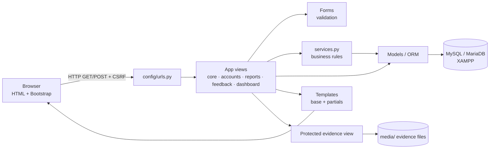
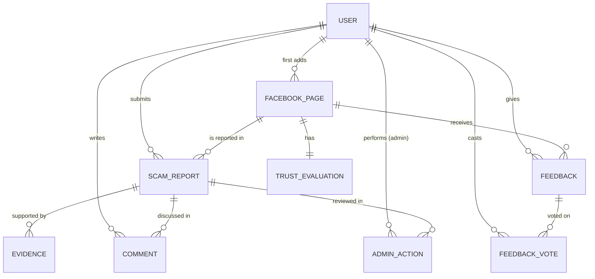
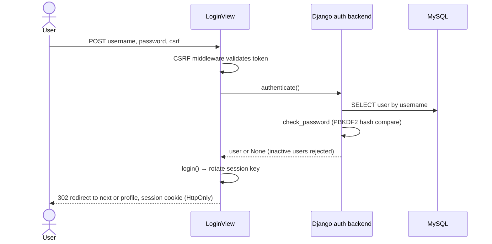

# My Trust — Technical Documentation & Implementation Guide

| | |
|---|---|
| **Project** | My Trust |
| **Thesis title** | Identification of Scam Patterns in Facebook-Based Online Sales Pages |
| **Type** | Undergraduate Software Engineering thesis project |
| **Source requirements** | `MASTER PROMPT.doc` (repository root) |
| **Guide version** | 1.0 — 22 Nov 2026 |
| **Final deadline** | **Mon 30 Nov 2026** (8 calendar days from guide creation) |
| **Progress tracker** | [`docs/PROGRESS.md`](PROGRESS.md) |

> **How to use this guide.** Sections 1–14 are the reference documentation (what we build and why).
> Section 15 is the roadmap. Section 16 lists every task. We execute **one task at a time** using
> the workflow in Section 13; complete source code for each task is provided when we reach it, written
> against the real state of your repository at that moment.

---

## Table of Contents

1. [Requirements Analysis](#1-requirements-analysis)
2. [Project Overview & Objectives](#2-project-overview--objectives)
3. [Functional Requirements](#3-functional-requirements)
4. [Non-Functional Requirements](#4-non-functional-requirements)
5. [Technology Stack & Justification](#5-technology-stack--justification)
6. [System Architecture](#6-system-architecture)
7. [Project Folder Structure](#7-project-folder-structure)
8. [Database Design](#8-database-design)
9. [Trust Score Design](#9-trust-score-design)
10. [URL Routes (Application Interface)](#10-url-routes-application-interface)
11. [Authentication & Authorization](#11-authentication--authorization)
12. [Error Handling, Security, Testing, Deployment](#12-error-handling-security-testing-deployment)
13. [Development Workflow & Git Strategy](#13-development-workflow--git-strategy)
14. [Code Quality Standards](#14-code-quality-standards)
15. [Emergency Roadmap (22–30 Nov)](#15-emergency-roadmap-2230-nov)
16. [Phase & Task Breakdown](#16-phase--task-breakdown)
17. [Thesis Documentation Track](#17-thesis-documentation-track)
18. [Final Completion Checklist](#18-final-completion-checklist)

---

## 1. Requirements Analysis

### 1.1 Summary of the source document

My Trust is a server-rendered Django web application where consumers **report** suspicious Facebook
sales pages with **evidence**, the **community** gives feedback, **administrators verify** reports, and
each page shows a **trust score** that clearly separates *allegations*, *community opinion*, and
*admin-verified findings*.

### 1.2 Critical constraint: the deadline

Today is **Sun 22 Nov 2026**. The deadline is **Mon 30 Nov 2026**. That leaves **8 days** for:
the application, testing, diagrams, screenshots, a full thesis report, and printing/binding.

This is very tight. The plan here works only under these conditions:

* The scope is limited to the **MVP** (Section 3.3). "Should-have" features are built only if their day's work is finished on time.
* The thesis is written **in parallel** (Section 17). Chapters 1–2 come largely from your completed proposal.
* Printing and binding are planned for **Sun 29 Nov**, so the effective build deadline is **Fri 27 Nov**.
* Coding runs about 12–14 small tasks per day. That is realistic only because each task is small and its code is provided.

### 1.3 Dependency map between features

```
Environment ─▶ Django project/config ─▶ Custom User (MUST precede first migrate)
                                           │
                    ┌──────────────────────┼───────────────────────────┐
                    ▼                      ▼                           ▼
             FacebookPage ──▶ ScamReport ──▶ Evidence           Auth views (register/login)
                    │             │                                    │
                    ▼             ▼                                    ▼
             TrustEvaluation ◀── AdminAction (approve/reject)    Role helpers (admin_required)
                    ▲                                                  │
                    └──────── Feedback ◀── FeedbackVote                ▼
                                 Comment ─▶ ScamReport           Admin dashboard
Search/filters depend on FacebookPage + ScamReport + TrustEvaluation.
```

### 1.4 Technical challenges identified

| # | Challenge | Mitigation |
|---|-----------|------------|
| C1 | **XAMPP often ships MariaDB 10.4**, but Django 5.x requires **MariaDB ≥ 10.5**. | Check the version in Task P1-T01. Decision tree in §5.2. |
| C2 | The same Facebook page can be written many ways (`m.facebook.com`, `www.`, `fb.com`, trailing `/`, `?ref=`), which creates duplicate pages. | Normalize URLs in one utility function, add a unique DB constraint on the normalized URL, and unit-test it (P4-T01). |
| C3 | **Defamation risk**: an unverified complaint must never label a page "fraudulent". | Unverified reports do not affect the score. Labels never say "fraud". A disclaimer is shown on every page (§9). |
| C4 | Evidence screenshots may contain personal data (phone numbers, payment IDs). | Evidence is **never public**. It is served through an access-checked view to the reporter and admins only (P5-T05). |
| C5 | Malicious uploads (scripts renamed to `.jpg`). | Check extension, size, and count, and verify content with Pillow (P4-T03). |
| C6 | The custom user model is hard to add after the first migration. | It is created before any `migrate` (P3-T01). |
| C7 | Trust score drifts out of date. | One service function recalculates it. It is called explicitly after every feedback change and admin decision, and a management command recalculates all pages. |

### 1.5 Missing information and ambiguities

**Needed from you (blocking for the thesis, not for coding):**

| # | Question | Why it matters |
|---|----------|----------------|
| Q1 | Your university's thesis formatting guideline (margins, font, citation style, page order). | The source says not to invent it. Chapters can be drafted now and formatted later. |
| Q2 | Is 30 Nov the **printed + bound submission**, the defense, or a soft-copy upload? | Determines the real build deadline. |
| Q3 | Can you share your **completed proposal**? | Chapters 1–2 (problem statement, objectives, literature review, references) should reuse it. That avoids invented citations and saves about 1.5 days. |

**Assumptions made** (please correct any that are wrong):

| # | Assumption |
|---|------------|
| A1 | The app runs **locally** on your laptop for the demo/defense. No cloud deployment (§12.4). |
| A2 | The UI language is English. |
| A3 | Admins are created with `createsuperuser` or by setting a user's role in Django admin. There is no public admin sign-up. |
| A4 | Only `facebook.com` / `fb.com` URLs are accepted (pages, `profile.php?id=` profiles). |
| A5 | Unverified (pending) reports are shown publicly **with a clear "Unverified allegation" badge**. Rejected reports are hidden. Evidence is never public. |
| A6 | Evidence: JPG/PNG only, ≤ 5 MB each, ≤ 5 files per report. |
| A7 | No email features (verification, password reset by email). There is no SMTP server in a local XAMPP setup. Password *change* while logged in is supported. |
| A8 | **No automated Facebook scraping or API use.** All data is user-submitted. Scraping violates Facebook's terms and can't be delivered in 8 days. It is listed as future work. |
| A9 | "Scam pattern identification" (thesis title) is shown as **aggregated statistics**: reports per scam category, per page, and over time, plus repeated reports against the same page. Machine learning is out of scope and listed as future work. |
| A10 | `TIME_ZONE` is set to your local zone. You confirm it in P2-T04. |

---

## 2. Project Overview & Objectives

**Problem.** Facebook-based sellers commit advance-payment fraud, non-delivery, fake product ads, brand
impersonation, and customer harassment. Buyers have no central place to check a seller's history.

**Solution.** A community reporting and reputation platform with administrator verification.

**Objectives** (from source §3, each mapped to the module that delivers it):

| ID | Objective | Delivered by |
|----|-----------|--------------|
| O1 | Centralized platform for reporting suspicious pages | `reports` |
| O2 | Submit complaints with supporting evidence | `reports` (Evidence) |
| O3 | Community feedback and trust evaluation | `feedback`, `trustscore` |
| O4 | Help consumers identify risky sellers | Search + page detail + trust badge |
| O5 | Administrators verify and manage reports | `dashboard` |
| O6 | Improve awareness and transparency | Landing page, community activity, category statistics |

---

## 3. Functional Requirements

Priority: **M** = Must (MVP), **S** = Should (build if on schedule), **C** = Cut (future work).

### 3.1 Requirements list

| ID | Requirement | Module | Pri |
|----|-------------|--------|-----|
| FR-01 | Visitor can register with username, email (unique), password | accounts | M |
| FR-02 | User can log in and log out (logout via POST) | accounts | M |
| FR-03 | Passwords stored hashed (Django PBKDF2) | accounts | M |
| FR-04 | User can view their profile | accounts | M |
| FR-05 | User can edit profile (first/last name, email) | accounts | S |
| FR-06 | User can change password while logged in | accounts | S |
| FR-07 | Role-based access: `USER`, `ADMIN` | accounts | M |
| FR-08 | User sees history of their own reports with status | reports | M |
| FR-09 | Logged-in user submits a report: page name, page URL, scam category, title, description, optional incident date and amount lost | reports | M |
| FR-10 | User attaches 1–5 evidence images to a report | reports | M |
| FR-11 | Report starts as `PENDING` (under admin review) | reports | M |
| FR-12 | Reporter can view report status and admin's note | reports | M |
| FR-13 | Reporter can add evidence when admin requests it (`NEEDS_EVIDENCE`) | reports | M |
| FR-14 | Duplicate pages prevented via normalized URL | reports | M |
| FR-15 | Logged-in user gives positive/negative feedback on a page (+ optional comment), **one per user per page**, editable | feedback | M |
| FR-16 | Trust score (0–100) and label computed per page | trustscore | M |
| FR-17 | Page detail shows verified reports, unverified allegations and community feedback in **separate, labeled sections** | reports/trustscore | M |
| FR-18 | Search pages by name or URL | reports | M |
| FR-19 | Filter by scam category and verification status | reports | M |
| FR-20 | Browse previously reported pages (paginated) | reports | M |
| FR-21 | Admin dashboard: statistics (totals, reports by status, **reports by category**) | dashboard | M |
| FR-22 | Admin reviews report + evidence; approves, rejects or requests evidence with a note | dashboard | M |
| FR-23 | Every admin decision recorded in an audit log | dashboard | M |
| FR-24 | Admin lists users and activates/deactivates them | dashboard | M |
| FR-25 | Admin hides/unhides inappropriate feedback and comments | dashboard | S |
| FR-26 | Admin views list of reported pages with counts | dashboard | M |
| FR-27 | Admin views platform activity log | dashboard | S |
| FR-28 | Logged-in users comment on a report | feedback | S |
| FR-29 | Users like/dislike others' feedback (one vote per user, toggle) | feedback | S |
| FR-30 | Landing page shows recent community activity | core | S |
| FR-31 | Email verification / reset by email | — | C |
| FR-32 | Automated Facebook data collection | — | C |
| FR-33 | ML-based scam prediction | — | C |
| FR-34 | Charts library visualisations (counts shown as tables/progress bars instead) | — | C |

### 3.2 Use-case actors

* **Visitor** (not logged in): browse/search pages, view page detail, register, log in.
* **Registered User**: everything a Visitor can, plus submit reports, upload evidence, give feedback, comment, vote, view own history, manage profile.
* **Administrator**: everything a User can, plus the dashboard, moderation, user management, and the audit log.

### 3.3 MVP definition

FR-01…04, 07…24, 26. That is a complete demonstrable loop:
**register → report page with evidence → admin verifies → trust score changes → another user searches and sees result → gives feedback.**

---

## 4. Non-Functional Requirements

| ID | Category | Requirement | How verified |
|----|----------|-------------|--------------|
| NFR-01 | Security | Hashed passwords, CSRF on all POST forms, ORM-only queries, upload validation, role checks on every admin view | Tests + `manage.py check --deploy` review |
| NFR-02 | Privacy | Evidence and reporter emails never shown publicly. Reporter shown by username only. | Access-control tests |
| NFR-03 | Usability | Responsive Bootstrap 5 layout usable at 375 px and 1366 px widths | Manual test in Chrome DevTools |
| NFR-04 | Performance | Page lists paginated (10–20 per page). No N+1 queries on lists (`select_related`/`annotate`) | Manual + Django debug check |
| NFR-05 | Maintainability | Modular apps, business logic in `services.py`, no duplicated logic, PEP 8 | Code review per task |
| NFR-06 | Reliability | Report + evidence saved atomically (`transaction.atomic`) | Test |
| NFR-07 | Integrity | DB constraints: unique normalized URL, unique (user, page) feedback, unique (user, feedback) vote | Model tests |
| NFR-08 | Fairness | No page auto-labeled fraudulent. Unverified reports excluded from score. | Trust score unit tests |
| NFR-09 | Portability | Runs on Windows 10/11 + XAMPP. Setup documented in README. | Fresh-setup check in P12 |
| NFR-10 | Data | MySQL/MariaDB with `utf8mb4` (supports Bangla/emoji text in descriptions) | DB creation step |

---

## 5. Technology Stack & Justification

### 5.1 Stack

| Layer | Choice | Justification |
|-------|--------|---------------|
| Language | Python 3.12 or 3.13 | Required by source. Mature wheels for `mysqlclient` and Pillow on Windows. Avoid a brand-new Python release in case wheels are missing. |
| Framework | **Django 5.2 LTS** (see §5.2) | Required. Built-in auth, ORM, admin, CSRF, forms, test runner. Supported LTS. |
| DB | MySQL/MariaDB via XAMPP | Required by source |
| DB driver | `mysqlclient` | Django's officially recommended MySQL driver |
| Images | `Pillow` | Required by `ImageField`. Verifies uploaded images are real images. |
| Config | `python-dotenv` | Keeps `SECRET_KEY` and DB password out of Git. One tiny dependency. |
| Frontend | HTML5, CSS3, **Bootstrap 5.3 (CDN)**, Bootstrap Icons, minimal vanilla JS | Required. No build step. |
| Testing | Django `TestCase` (built-in `unittest`) | No extra dependency. Enough for unit, integration and access tests. |
| Diagrams | Mermaid (in Markdown, renders on GitHub) + draw.io for thesis figures | Free, versionable |
| VCS | Git + GitHub | Already set up |

**Deliberately not used:** Django REST Framework (no API consumers), React/Vue (not required, adds a build step),
Celery/Redis (no background jobs needed), pytest (built-in runner is enough), Chart.js (deadline; counts in tables).

### 5.2 Django version decision tree (resolved in P1-T01)

| Your MariaDB/MySQL version | Action |
|---|---|
| MariaDB ≥ 10.6 or MySQL ≥ 8.0.11 | Use **Django 5.2 LTS**. ✅ preferred |
| MariaDB 10.5 | Django 5.2 LTS works. |
| **MariaDB 10.4** (common in XAMPP 8.x) | Option A (recommended): install **MySQL 8 / MariaDB 10.11** separately, or replace XAMPP's MariaDB. Option B (fastest): use **Django 4.2**. It supports MariaDB 10.4 but its security support has ended, so note this in the thesis limitations. We decide together after seeing your output. |

> **Resolved 22 Nov 2026:** XAMPP's MariaDB was upgraded from 10.4.32 to **MariaDB 10.11.20 LTS** (official Windows ZIP,
> SHA-256 verified). It still runs inside XAMPP on **port 3306**, with phpMyAdmin. All existing databases were restored and
> verified by row count and checksum. My Trust uses **Django 5.2 LTS**, database `mytrust_db`, and the dedicated account
> `mytrust_user` (never root). Credentials are in the gitignored `.env`. The separate MySQL 8.4 service on port 3307
> belongs to another project and is **not** used.
>
> *Thesis note (limitation/decision):* XAMPP 8.2.12 bundles MariaDB 10.4, which Django 5.2 does not support, so the bundled
> server was upgraded to the 10.11 LTS release.

---

## 6. System Architecture

### 6.1 Architectural style

Django's **MVT (Model–View–Template)** pattern, as a modular monolith. Each Django app owns one bounded area.
Business rules that span apps (trust score, report submission, moderation decisions) live in
`services.py` modules, so views stay thin and logic is unit-testable.



### 6.2 Django apps and responsibilities

| App | Owns (models) | Responsibilities |
|-----|---------------|------------------|
| `core` | — | Landing page, about/contact, shared validators and mixins, error pages. Added to the 5 apps in the source because shared/landing code doesn't belong to any one domain app. |
| `accounts` | `User` | Registration, login/logout, profile, roles, `admin_required` decorator |
| `reports` | `FacebookPage`, `ScamReport`, `Evidence` | Submission, history, report detail, evidence, search & page detail |
| `feedback` | `Feedback`, `Comment`, `FeedbackVote` | Page feedback, report comments, votes |
| `trustscore` | `TrustEvaluation` | Score calculation service, badge template, recalculation command |
| `dashboard` | `AdminAction` | Admin statistics, review queue, moderation, user management, audit log |

**Dependency direction (no cycles):** `dashboard → feedback → reports → accounts`, `trustscore → reports, feedback`; every app can use `core`.
Callers invoke `trustscore.services.recalculate_trust(page)` explicitly, not through signals. Explicit calls are easier to follow and to explain in a viva.

---

## 7. Project Folder Structure

```
MY-TRUST/
├── .env                    # local secrets (NOT committed)
├── .env.example            # template of required variables (committed)
├── .gitignore
├── README.md
├── requirements.txt
├── manage.py
├── MASTER PROMPT.doc       # original requirements
├── config/                 # project package (settings/urls)
│   ├── __init__.py
│   ├── settings.py
│   ├── urls.py
│   ├── wsgi.py
│   └── asgi.py
├── core/
│   ├── views.py  urls.py  validators.py
│   └── tests/
├── accounts/
│   ├── models.py  forms.py  views.py  urls.py  admin.py  decorators.py
│   ├── migrations/
│   └── tests/
├── reports/
│   ├── models.py  forms.py  views.py  urls.py  admin.py
│   ├── services.py         # submit_report(), normalize_facebook_url()
│   ├── utils.py
│   ├── management/commands/seed_demo.py
│   ├── migrations/
│   └── tests/
├── feedback/
│   ├── models.py  forms.py  views.py  urls.py  admin.py
│   ├── migrations/
│   └── tests/
├── trustscore/
│   ├── models.py  services.py  admin.py
│   ├── management/commands/recalculate_trust.py
│   ├── migrations/
│   └── tests/
├── dashboard/
│   ├── models.py  views.py  urls.py  services.py  admin.py
│   ├── migrations/
│   └── tests/
├── templates/
│   ├── base.html
│   ├── partials/  _navbar.html _footer.html _messages.html _pagination.html
│   │              _trust_badge.html _status_badge.html _form_field.html
│   ├── core/  accounts/  registration/  reports/  feedback/  dashboard/
│   └── 403.html 404.html 500.html
├── static/
│   ├── css/main.css
│   ├── js/main.js
│   └── img/
├── media/                  # uploaded evidence (NOT committed)
└── docs/
    ├── IMPLEMENTATION_GUIDE.md
    ├── PROGRESS.md
    ├── diagrams/           # ER, use case, DFD, architecture, activity, sequence
    ├── testing/test-cases.md
    └── screenshots/
```

Each app's `tests/` is a package (`__init__.py`, `test_models.py`, `test_views.py`, …) so tests stay organized as they grow.

---

## 8. Database Design

### 8.1 ER diagram



### 8.2 Schema

Conventions: every table has an auto `id BIGINT` PK (`DEFAULT_AUTO_FIELD = BigAutoField`). `created_at`/`updated_at`
use `auto_now_add`/`auto_now`. Choice fields are stored as short `VARCHAR` codes.

**`accounts_user`** (extends Django `AbstractUser`: username, password hash, first/last name, is_active, is_staff, is_superuser, date_joined, last_login)

| Field | Type | Constraints / validation |
|-------|------|--------------------------|
| email | EmailField(254) | **unique**, required |
| role | CharField(10) | choices `USER`, `ADMIN`; default `USER` |

`is_platform_admin` property = `role == ADMIN or is_superuser`.

**`reports_facebookpage`**

| Field | Type | Constraints / validation |
|-------|------|--------------------------|
| name | CharField(150) | required, stripped |
| url | URLField(255) | **unique**; always stored normalized (`https://www.facebook.com/<path>`) |
| created_by | FK → User | `SET_NULL`, nullable |
| created_at / updated_at | DateTime | auto |

Index on `name`.

**`reports_scamreport`**

| Field | Type | Constraints / validation |
|-------|------|--------------------------|
| page | FK → FacebookPage | `PROTECT`, related_name `reports` |
| reporter | FK → User | `PROTECT`, related_name `reports` |
| category | CharField(20) | choices: `ADVANCE_PAYMENT`, `NON_DELIVERY`, `FAKE_PRODUCT`, `IMPERSONATION`, `HARASSMENT`, `OTHER` |
| title | CharField(150) | required, min 10 chars |
| description | TextField | required, 30–5000 chars |
| incident_date | DateField | nullable, not in the future |
| amount_lost | Decimal(10,2) | nullable, ≥ 0 |
| status | CharField(20) | choices `PENDING`, `NEEDS_EVIDENCE`, `APPROVED`, `REJECTED`; default `PENDING`; indexed |
| admin_note | TextField | blank; latest note shown to reporter |
| reviewed_at | DateTime | nullable |
| created_at / updated_at | DateTime | auto |

Indexes: (`page`, `status`), (`status`, `created_at`). `APPROVED` is shown in the UI as **"Verified by admin"**.

**`reports_evidence`**

| Field | Type | Constraints / validation |
|-------|------|--------------------------|
| report | FK → ScamReport | `CASCADE`, related_name `evidence` |
| file | ImageField | `upload_to` → `evidence/%Y/%m/<uuid>.<ext>`; jpg/jpeg/png; ≤ 5 MB; Pillow-verified |
| original_name | CharField(255) | for display only |
| size_bytes | PositiveIntegerField | |
| uploaded_at | DateTime | auto |

Max 5 per report, enforced in form/service.

**`feedback_feedback`**

| Field | Type | Constraints / validation |
|-------|------|--------------------------|
| page | FK → FacebookPage | `CASCADE`, related_name `feedback` |
| user | FK → User | `CASCADE` |
| sentiment | CharField(10) | `POSITIVE` / `NEGATIVE` |
| comment | TextField | blank, ≤ 1000 chars |
| is_hidden | Boolean | default False (moderation) |
| created_at / updated_at | DateTime | auto |

**UniqueConstraint(page, user)** prevents duplicate feedback.

**`feedback_comment`**

| Field | Type | Constraints |
|-------|------|-------------|
| report | FK → ScamReport | `CASCADE`, related_name `comments` |
| user | FK → User | `CASCADE` |
| body | TextField | 2–1000 chars |
| is_hidden | Boolean | default False |
| created_at | DateTime | auto |

**`feedback_feedbackvote`**

| Field | Type | Constraints |
|-------|------|-------------|
| feedback | FK → Feedback | `CASCADE`, related_name `votes` |
| user | FK → User | `CASCADE` |
| value | SmallInteger | choices `+1` (like), `-1` (dislike) |
| created_at | DateTime | auto |

**UniqueConstraint(feedback, user)**. A user cannot vote on their own feedback (enforced in the service).

**`trustscore_trustevaluation`**

| Field | Type | Constraints |
|-------|------|-------------|
| page | OneToOne → FacebookPage | `CASCADE`, related_name `trust` |
| score | PositiveSmallInteger | 0–100 |
| label | CharField(20) | `INSUFFICIENT`, `GOOD`, `MIXED`, `CAUTION` |
| positive_count / negative_count | PositiveInteger | visible feedback only |
| verified_report_count / pending_report_count | PositiveInteger | |
| calculated_at | DateTime | auto_now |

This is a stored snapshot (denormalized on purpose) so lists can sort and filter by score cheaply. It is always rebuilt from the source tables by one function.

**`dashboard_adminaction`**

| Field | Type | Constraints |
|-------|------|-------------|
| admin | FK → User | `PROTECT` |
| action_type | CharField(30) | `APPROVE_REPORT`, `REJECT_REPORT`, `REQUEST_EVIDENCE`, `HIDE_FEEDBACK`, `UNHIDE_FEEDBACK`, `HIDE_COMMENT`, `UNHIDE_COMMENT`, `ACTIVATE_USER`, `DEACTIVATE_USER` |
| report | FK → ScamReport | nullable, `SET_NULL` |
| target_user | FK → User | nullable, `SET_NULL` |
| target_type / target_id | CharField(20) / PositiveInteger | nullable; for feedback/comment targets |
| note | TextField | blank |
| created_at | DateTime | auto, indexed |

**Normalization:** all tables are in 3NF. `TrustEvaluation` is the one intentional denormalization (a derived cache), and the thesis should justify it.

### 8.3 Migration commands

```powershell
python manage.py makemigrations          # create migration files from model changes
python manage.py sqlmigrate reports 0001 # (optional) view SQL for the thesis
python manage.py migrate                 # apply to MySQL
python manage.py showmigrations          # verify
```

### 8.4 Sample data

`python manage.py seed_demo` (P4-T08) creates: 1 admin, 5 users, 8 pages, ~20 reports across all
categories and statuses, feedback, and comments. It is idempotent, so it can be re-run safely. These are the defense demo data.
**Sample data are demo fixtures. They must never be presented as real research findings.**

---

## 9. Trust Score Design

### 9.1 Principles (from source §4C)

1. **Allegations ≠ facts.** `PENDING`/`NEEDS_EVIDENCE` reports are displayed but **do not change the score**.
2. **Only admin-verified (`APPROVED`) reports** apply a penalty.
3. Community feedback is shown as *opinion*, separately.
4. No label ever says "Fraud" or "Scam". The strongest label is **"Caution"**, and verified findings are stated as facts ("2 reports verified by admin").

### 9.2 Formula

```
P = visible positive feedback, N = visible negative feedback, V = approved reports

community_ratio = (P + 1) / (P + N + 2)        # Laplace smoothing → 0.5 with no data
base_score      = 100 × community_ratio
penalty         = min(15 × V, 60)
score           = clamp(round(base_score − penalty), 0, 100)

label:
  INSUFFICIENT  if (P + N) < 3 and V == 0
  CAUTION       if score < 40
  MIXED         if 40 ≤ score < 70
  GOOD          if score ≥ 70
```

**Worked example:** P = 8, N = 2, V = 1 → ratio = 9/12 = 0.75 → 75 − 15 = **60 → MIXED**.

The constants (15, 60, 3, 40/70) are defined once in `trustscore/services.py`, so they are easy to justify and tune.
In the thesis this is a transparent **rule-based heuristic**, not a statistical model.

### 9.3 Display

The badge shows score, label, and three separate counts: *Verified reports*, *Unverified allegations*, and *Community feedback (👍/👎)*.
Every page also shows this disclaimer: *"Scores reflect community feedback and admin-verified reports only. Unverified reports are allegations."*

---

## 10. URL Routes (Application Interface)

There is no JSON API. Routes return server-rendered HTML. All POST routes require a CSRF token.

| Method | URL | View | Access |
|--------|-----|------|--------|
| GET | `/` | core:home | Public |
| GET | `/about/`, `/contact/` | core | Public |
| GET/POST | `/accounts/register/` | accounts:register | Anonymous |
| GET/POST | `/accounts/login/` | Django `LoginView` | Anonymous |
| POST | `/accounts/logout/` | Django `LogoutView` | Logged in |
| GET | `/accounts/profile/` | accounts:profile | Logged in |
| GET/POST | `/accounts/profile/edit/` | accounts:profile_edit | Logged in |
| GET/POST | `/accounts/password/change/` | Django `PasswordChangeView` | Logged in |
| GET | `/pages/` | reports:page_list (`?q=&category=&status=&page=`) | Public |
| GET | `/pages/<id>/` | reports:page_detail | Public |
| GET/POST | `/reports/new/` | reports:report_create | Logged in |
| GET | `/reports/mine/` | reports:my_reports | Logged in |
| GET | `/reports/<id>/` | reports:report_detail | Public if APPROVED/PENDING; owner/admin otherwise |
| GET/POST | `/reports/<id>/evidence/add/` | reports:evidence_add | Owner, status NEEDS_EVIDENCE |
| GET | `/evidence/<id>/` | reports:evidence_file | Owner or admin |
| POST | `/pages/<id>/feedback/` | feedback:feedback_save | Logged in |
| POST | `/feedback/<id>/delete/` | feedback:feedback_delete | Owner |
| POST | `/feedback/<id>/vote/` | feedback:feedback_vote | Logged in, not owner |
| POST | `/reports/<id>/comments/` | feedback:comment_create | Logged in |
| GET | `/dashboard/` | dashboard:overview | Admin |
| GET | `/dashboard/reports/` | dashboard:report_queue (`?status=`) | Admin |
| GET/POST | `/dashboard/reports/<id>/` | dashboard:report_review | Admin |
| GET | `/dashboard/users/` | dashboard:user_list | Admin |
| POST | `/dashboard/users/<id>/toggle-active/` | dashboard:user_toggle | Admin (not self) |
| GET | `/dashboard/pages/` | dashboard:page_list | Admin |
| GET | `/dashboard/moderation/` | dashboard:moderation | Admin |
| POST | `/dashboard/moderation/<type>/<id>/toggle/` | dashboard:moderation_toggle | Admin |
| GET | `/dashboard/activity/` | dashboard:activity | Admin |
| — | `/admin/` | Django admin (superuser fallback) | Superuser |

---

## 11. Authentication & Authorization

### 11.1 Authentication flow



### 11.2 Authorization rules

| Mechanism | Used for |
|-----------|----------|
| `@login_required` | All user actions (report, feedback, comment, vote, profile) |
| `@admin_required` (custom, in `accounts/decorators.py`) | Every `dashboard` view. Returns **403** for logged-in non-admins and redirects anonymous users to login. |
| Object-level checks in views | Owner-only actions (edit/delete own feedback, add evidence to own report, view own rejected report) |
| `is_active=False` | Deactivated users cannot log in (Django default) |

**Admin self-protection:** an admin cannot deactivate themself.

---

## 12. Error Handling, Security, Testing, Deployment

### 12.1 Error handling strategy

| Layer | Strategy |
|-------|----------|
| Forms | Field + `clean()` validation. Errors rendered next to fields. Never trust client-side validation alone. |
| Views | `get_object_or_404`. `PermissionDenied` → 403 page. Invalid POST → re-render form with errors. |
| Services | Raise `ValidationError` for business-rule violations (e.g., too many evidence files, voting own feedback). Views catch these and show messages. |
| Transactions | `transaction.atomic()` around report + page + evidence creation and around admin decisions + audit log + trust recalculation |
| User feedback | Django `messages` framework (success/error alerts in `_messages.html`) |
| Pages | Custom `403.html`, `404.html`, `500.html` (shown when `DEBUG=False`) |
| Logging | Console logging config. Errors logged with `logger.exception` in services. No sensitive data in logs. |

### 12.2 Security considerations (source §8 checklist)

| Requirement | Implementation | Task |
|-------------|----------------|------|
| Password hashing | Django default PBKDF2 hasher + `AUTH_PASSWORD_VALIDATORS` | P3 |
| CSRF | `CsrfViewMiddleware` + `` in every form. Logout is POST-only. | all |
| Input validation | Django forms, model validators, length limits | P4–P8 |
| File validation | Extension whitelist, 5 MB limit, Pillow `verify()`, randomized UUID filenames, max 5 files | P4-T03 |
| Evidence handling | Files **not** exposed via public `MEDIA_URL`. Served via access-checked view with `FileResponse`. | P5-T05 |
| SQL injection | ORM only. No raw SQL. | all |
| XSS | Django autoescaping. Never use `|safe` on user content. | all |
| Sessions | `SESSION_COOKIE_HTTPONLY`, `SESSION_COOKIE_AGE` (2 weeks default), `CSRF_COOKIE_HTTPONLY`. Secure flags documented for HTTPS. | P11-T01 |
| Clickjacking | `XFrameOptionsMiddleware` (DENY) | default |
| Secrets | `.env` (gitignored). `.env.example` committed. | P2-T02 |
| Least privilege DB | Dedicated MySQL user `mytrust_user` with rights only on `mytrust_db` (not `root`) | P1-T04 |
| Data exposure | Public pages show usernames only, never emails. Evidence private. | P5, P7 |
| Brute force | Out of scope (a package like django-axes would add a dependency). Listed as a limitation. | — |

### 12.3 Testing strategy

| Level | Tool | What |
|-------|------|------|
| Unit | `django.test.TestCase` / `SimpleTestCase` | URL normalization, trust score formula, form validators, model constraints |
| Integration | `TestCase` + `Client` | Report submission end-to-end (page + report + evidence created), admin decision updates trust + audit log |
| Functional | `Client` + manual | Each user story through the UI |
| Authentication | `Client` | Register, login, logout, inactive login refused |
| Access control | `Client` | Every dashboard URL: anonymous → redirect, user → 403, admin → 200. Evidence privacy. |
| Form validation | `TestCase` | Invalid URL, short description, future date, negative amount |
| File upload | `SimpleUploadedFile` | Valid PNG accepted, fake PNG, `.exe`, >5 MB, and 6 files all rejected |
| Database | `TestCase` | Unique constraints raise `IntegrityError` |
| Usability | Manual checklist | Mobile/desktop, navigation, clarity of trust labels |

Run all tests: `python manage.py test`. On MySQL, Django creates a temporary `test_mytrust_db`, so the DB user needs CREATE privilege (granted in P1-T04).
Manual test results go in `docs/testing/test-cases.md` with columns **ID | Scenario | Input | Expected | Actual | Status**.
**Actual/Status columns are filled only with real observed results.**

### 12.4 Deployment strategy

* **Target:** local demo machine (Windows + XAMPP), as agreed in A1.
* **Demo-readiness steps (P12):** `DEBUG=False` run-through with `ALLOWED_HOSTS=127.0.0.1,localhost`, then `collectstatic`.
  Locally `runserver` won't serve static files when DEBUG is False, so use `runserver --insecure`. This is acceptable for a local demo and stated honestly in the thesis.
* Fresh-install rehearsal from README: clone, venv, install, create DB, migrate, seed, run.
* DB backup: `mysqldump` of the demo DB into `docs/demo/` (optional), so a laptop failure on defense day is recoverable.
* Cloud deployment (e.g., PythonAnywhere) is **future work**.

---

## 13. Development Workflow & Git Strategy

### 13.1 Per-task workflow (every task)

1. Read the task in §16. 2. Review current structure (`git status`, open files). 3. Identify files.
4. Plan. 5. Implement **only this task**. 6. Run the task's verification (+ `python manage.py check`, + tests once they exist).
7. Fix errors. 8. Self-review the diff (`git diff`). 9. Confirm acceptance criteria. 10. **Share results with me for review.**
11. Commit with the given message. 12. Update `docs/PROGRESS.md`. 13. Next task.

### 13.2 Branching

Given one developer and 8 days, use **one short-lived branch per phase**, merged into `main` when the phase is verified:

```powershell
git switch main
git pull
git switch -c feature/p3-accounts       # start phase
# ... task commits ...
git switch main
git merge --no-ff feature/p3-accounts -m "merge: phase 3 accounts"
git push origin main
git branch -d feature/p3-accounts
```

Push the feature branch at the end of every day too (`git push -u origin feature/p3-accounts`) as an off-laptop backup.

### 13.3 Commit rules

* One task = one commit (Conventional Commits: `feat`, `fix`, `chore`, `docs`, `test`, `refactor`, `style`).
* Stage **specific files** (`git add path1 path2`), never blindly `git add .`. Run `git status` before every commit.
* Never commit: `.env`, `venv/`, `media/`, `__pycache__/`, `*.sqlite3`, DB dumps containing real user data.
* Updating `PROGRESS.md` goes in the same commit as the task it records.
* Tasks with no file changes (e.g., installing software) produce **no commit**. Their results are recorded in the next docs commit.
* Release tag at the end: `git tag -a v1.0.0 -m "Thesis submission version"`.

---

## 14. Code Quality Standards

* PEP 8, 4-space indents, max line ~100. Names: `snake_case` functions, `PascalCase` classes, templates `snake_case.html`.
* Thin views, logic in `services.py`, validation in forms/validators. Never duplicate the trust formula or URL normalization.
* Function-based views for clarity (easier to explain in the viva). Django generic class views only where they remove real boilerplate (auth views, simple lists).
* Every model gets `__str__`, `Meta.ordering`, and `verbose_name` where useful.
* Templates extend `base.html` and reuse partials. No inline styles. Colors are defined as CSS variables in `main.css`.
* Short docstrings on services and non-obvious functions. No commented-out code in commits.
* No new dependency without a written justification in this guide.

---

## 15. Emergency Roadmap (22–30 Nov)

| Day | Date | Code phases | Thesis track (evenings) | End-of-day gate |
|-----|------|-------------|-------------------------|-----------------|
| 1 | Sun 22 | P1 Environment, P2 Skeleton | T1 collect proposal, guidelines | Landing page renders, MySQL connected |
| 2 | Mon 23 | P3 Accounts, P4 Models | T2 Chapter 1 draft | All models migrated, seed data visible in admin |
| 3 | Tue 24 | P5 Reporting, P6 Trust score | T3 Chapter 2 from proposal | Report with evidence submitted; score computed |
| 4 | Wed 25 | P7 Search, P8 Feedback | T4 Chapter 3 + diagrams | Visitor can search and see trust; feedback works |
| 5 | Thu 26 | P9 Admin dashboard | T5 Chapter 4 draft | Full MVP loop demonstrable |
| 6 | Fri 27 | P10 UI polish, P11 Security + testing | T6 Chapter 5 with **real** results | All tests pass; test table filled; **code freeze** |
| 7 | Sat 28 | P12 README, screenshots, tag v1.0.0 | T7 Ch 6, abstract, front matter, formatting | Full draft to supervisor if possible |
| 8 | Sun 29 | Bug fixes only | T8 final proofreading, **print & bind** | Printed copy in hand |
| — | Mon 30 | — | **Submit** | ✅ |

**Fallback rules if behind schedule:** drop S-priority tasks first, in this order: FR-27 activity log, FR-29 votes, FR-30 activity feed, FR-25 moderation, FR-28 comments, FR-05/06 profile edit/password.
Record each drop in `PROGRESS.md` and in the thesis "Limitations / Future Work".

---

## 16. Phase & Task Breakdown

**Legend.** Each task lists **Objective/Why · Files · Changes · Depends · Verify (acceptance) · Commit**.
Complete source code and step-by-step instructions (§9 structure of the source: objective → commands → files → code → explanation → run → test → expected output → confirm) are given **when we reach each task**.
Tasks marked **(S)** are should-have. All commands run in the **VS Code terminal (PowerShell) at `C:\projects\MY-TRUST`** with the venv active, unless stated.

### Phase 1 — Environment & Repository Setup (Day 1)

**P1-T01 Verify development toolchain**
* *Objective/Why:* Confirm Python, pip, Git, VS Code and XAMPP MySQL work, and get the exact DB version. This resolves challenge C1 before any code depends on it.
* *Files:* none. *Depends:* —
* *Verify:* All commands print versions. MySQL starts in the XAMPP Control Panel. `SELECT VERSION();` returns a version.
* *Commit:* none (results recorded in P1-T02).

**P1-T02 Commit project documentation**
* *Objective/Why:* Put the guide, the progress tracker and the recorded tool versions under version control, so the plan is traceable.
* *Files:* `docs/IMPLEMENTATION_GUIDE.md`, `docs/PROGRESS.md` (fill the environment table).
* *Verify:* `git status` shows only these two files. GitHub shows them after the push.
* *Commit:* `docs: add implementation guide and progress tracker`

**P1-T03 Add .gitignore**
* *Why:* Must exist **before** the venv, `.env` or `media/` are created, so they are never committed.
* *Files:* `.gitignore` (Python, Django, venv, `.env`, `media/`, `staticfiles/`, `.vscode/`, `*.log`, DB dumps).
* *Verify:* create a dummy `.env`, run `git status`, and confirm it does not appear.
* *Commit:* `chore: add gitignore for Python and Django`

**P1-T04 Create MySQL database and dedicated user**
* *Why:* Least-privilege DB access and `utf8mb4` encoding (NFR-10).
* *Status:* ✅ done 22 Nov 2026 (see §5.2). The grants use escaped names (`mytrust\_db`, `test\_mytrust\_db`) because `_` is a wildcard in GRANT. `test_mytrust_db` is **not** pre-created: Django creates and drops it during tests, and a pre-existing copy would make Django ask to delete it.
* *Files:* none (SQL run with `C:\xampp\mysql\bin\mysql.exe` on port 3306): `CREATE DATABASE mytrust_db CHARACTER SET utf8mb4 COLLATE utf8mb4_unicode_ci;`, plus `CREATE USER` and `GRANT ALL ON mytrust_db.*` and `test_mytrust_db.*`.
* *Verify:* log in as `mytrust_user` and run `SHOW DATABASES;` → `mytrust_db` is listed.
* *Commit:* none (documented in README later).

**P1-T05 Create virtual environment and install pinned dependencies**
* *Why:* Isolated, reproducible environment.
* *Files:* `requirements.txt` (Django, mysqlclient, Pillow, python-dotenv, exact versions).
* *Changes:* `python -m venv venv`, activate, `pip install ...`, `pip freeze > requirements.txt`.
* *Verify:* `python -m django --version` and `python -c "import MySQLdb, PIL, dotenv"` succeed. `venv/` is not in `git status`.
* *Commit:* `chore: add pinned project dependencies`

### Phase 2 — Project Skeleton & Configuration (Day 1)

**P2-T01 Initialize Django project** — `django-admin startproject config .` → `manage.py`, `config/*`. *Verify:* `python manage.py check` → no issues. **Do not run `migrate` yet** (C6). *Commit:* `chore: initialize Django project`

**P2-T02 Load settings from environment** — `config/settings.py`, `.env` (not committed), `.env.example`. `SECRET_KEY`, `DEBUG`, `ALLOWED_HOSTS` read via python-dotenv. *Verify:* `check` passes, and removing `SECRET_KEY` from `.env` gives a clear error. *Commit:* `chore: load settings from environment variables`

**P2-T03 Configure MySQL connection** — `DATABASES` (engine mysql, `charset: utf8mb4`, `init_command` strict mode) reading `DB_*` vars. *Verify:* `python manage.py dbshell` (or a small `connection.ensure_connection()` check) connects. *Commit:* `chore: configure MySQL database connection`

**P2-T04 Configure templates, static, media, locale** — `TEMPLATES.DIRS`, `STATICFILES_DIRS`, `STATIC_ROOT`, `MEDIA_ROOT`, `TIME_ZONE`, `DEFAULT_AUTO_FIELD`, create `templates/`, `static/css/main.css`. *Verify:* `check` passes. *Commit:* `chore: configure templates, static and media settings`

**P2-T05 Create application modules** — `startapp` × 6 (`core accounts reports feedback trustscore dashboard`), add to `INSTALLED_APPS`, convert each `tests.py` into a `tests/` package. *Verify:* `check` passes. *Commit:* `chore: create application modules`

**P2-T06 Base layout** — `templates/base.html`, `partials/_navbar.html`, `_footer.html`, `_messages.html`, `static/css/main.css` (theme variables: dark navy/teal cybersecurity palette), `static/js/main.js`. Bootstrap 5.3 + Icons from jsDelivr CDN with pinned versions. *Verify:* rendered in P2-T07. *Commit:* `feat: add base layout with navbar and footer`

**P2-T07 Landing page** — `core/views.py:home`, `core/urls.py`, include in `config/urls.py`, `templates/core/home.html` (hero, search form → `/pages/`, how-it-works, scam category cards). *Verify:* `runserver` → `http://127.0.0.1:8000/` renders, is responsive at 375 px, and shows no console errors. *Commit:* `feat: add landing page`

### Phase 3 — Accounts & Access Control (Day 2)

**P3-T01 Custom User model with roles** ⚠️ — `accounts/models.py` (`User(AbstractUser)` + unique email + `role` + `is_platform_admin`), `AUTH_USER_MODEL = "accounts.User"`, then the **first** `makemigrations` + `migrate`. *Verify:* `showmigrations` all applied, and `accounts_user` table exists in phpMyAdmin. *Commit:* `feat: add custom user model with roles`

**P3-T02 User admin + superuser** — `accounts/admin.py` (`UserAdmin` subclass showing `role`), `createsuperuser`. *Verify:* log in at `/admin/` and see the role field. *Commit:* `feat: register user model in admin`

**P3-T03 Registration** — `accounts/forms.py` (`RegistrationForm(UserCreationForm)` with email uniqueness), `views.register`, `urls.py`, `templates/accounts/register.html`, `partials/_form_field.html`. Auto-login after registration. *Verify:* register works; duplicate email and weak password show errors; password is stored hashed (`pbkdf2_sha256$…` in DB). *Commit:* `feat: add user registration`

**P3-T04 Login & logout** — Django `LoginView`/`LogoutView` in `accounts/urls.py`, `templates/registration/login.html`, navbar logout as a POST form, `LOGIN_URL`/`LOGIN_REDIRECT_URL`/`LOGOUT_REDIRECT_URL`. *Verify:* login/logout flow works; wrong password shows an error; inactive user can't log in. *Commit:* `feat: add login and logout`

**P3-T05 Profile page** — `views.profile`, `templates/accounts/profile.html` (account info + report history placeholder). *Verify:* `/accounts/profile/` redirects to login when anonymous. *Commit:* `feat: add user profile page`

**P3-T06 (S) Profile edit & password change** — `ProfileForm`, `views.profile_edit`, `PasswordChangeView` + templates. *Verify:* edit saves; password change works and the user stays logged in. *Commit:* `feat: add profile editing and password change`

**P3-T07 Role-based access helper** — `accounts/decorators.py:admin_required`, navbar shows "Dashboard" link for admins only. *Verify:* tested in P3-T08. *Commit:* `feat: add admin_required access decorator`

**P3-T08 Accounts tests** — `accounts/tests/test_models.py`, `test_views.py`, `test_decorators.py`. *Verify:* `python manage.py test accounts` → all pass. *Commit:* `test: add accounts tests`

### Phase 4 — Domain Models & Admin (Day 2)

**P4-T01 FacebookPage + URL normalization** — `reports/utils.py:normalize_facebook_url`, `reports/models.py:FacebookPage`, migration, `reports/tests/test_utils.py` (≥ 10 URL variants incl. invalid hosts). *Commit:* `feat: add Facebook page model with URL normalization`

**P4-T02 ScamReport model** — model + choices + indexes + migration. *Verify:* `sqlmigrate` shows FK and indexes. *Commit:* `feat: add scam report model`

**P4-T03 Evidence model + upload validators** — `core/validators.py` (size, extension, image verify), `Evidence` with UUID `upload_to`, settings constants `EVIDENCE_MAX_BYTES`, `EVIDENCE_MAX_FILES`. *Verify:* tests for valid/invalid files. *Commit:* `feat: add evidence model with upload validation`

**P4-T04 Feedback, Comment, FeedbackVote models** — `feedback/models.py` with `UniqueConstraint`s, migration. *Commit:* `feat: add feedback, comment and vote models`

**P4-T05 TrustEvaluation model** — `trustscore/models.py`, migration. *Commit:* `feat: add trust evaluation model`

**P4-T06 AdminAction model** — `dashboard/models.py`, migration. *Commit:* `feat: add admin action audit log model`

**P4-T07 Register domain models in admin** — `admin.py` in reports/feedback/trustscore/dashboard (list_display, filters, search, evidence inline). *Verify:* all models are browsable in `/admin/`. *Commit:* `feat: register domain models in admin`

**P4-T08 Demo seed command** — `reports/management/commands/seed_demo.py` (idempotent, `--reset` flag). *Verify:* run twice → no duplicates, data visible in admin. *Commit:* `feat: add demo data seeding command`

**P4-T09 Model constraint tests** — tests for unique URL, unique feedback, unique vote, `__str__`. *Commit:* `test: add model constraint tests`

### Phase 5 — Reporting Module (Day 3)

**P5-T01 Report form** — `reports/forms.py:ReportForm` (page name, URL → normalized + validated, category, title, description, incident_date ≤ today, amount ≥ 0) + multi-file evidence field (Django 5.x pattern for multiple files). *Commit:* `feat: add scam report form with validation`

**P5-T02 Submission service + view** — `reports/services.py:submit_report()` (atomic: get_or_create page by normalized URL → report → evidence → recalc trust), `views.report_create`, template. *Verify:* submission creates 1 page, 1 report and N evidence rows; same URL in another variant reuses the page. *Commit:* `feat: implement report submission`

**P5-T03 My reports history** — `views.my_reports`, template, `partials/_status_badge.html`, link from profile/navbar. *Commit:* `feat: add user report history`

**P5-T04 Report detail** — `views.report_detail` with visibility rules (A5), admin note shown to owner. *Commit:* `feat: add report detail page`

**P5-T05 Protected evidence serving** — `views.evidence_file` (`FileResponse`, owner/admin only). `MEDIA_URL` is **not** routed publicly. *Verify:* owner sees the image, another user gets 403, anonymous user is redirected. *Commit:* `feat: serve evidence through access-controlled view`

**P5-T06 Add evidence on request** — `views.evidence_add` (only for `NEEDS_EVIDENCE`, max total 5; moves status back to `PENDING`). *Commit:* `feat: allow adding evidence when requested`

**P5-T07 Reporting tests** — form validation, submission integration, upload rejection cases, access rules. *Commit:* `test: add reporting module tests`

### Phase 6 — Trust Score (Day 3)

**P6-T01 Score calculation (pure function)** — `trustscore/services.py:calculate_score(P, N, V)` returning (score, label), with constants, plus `tests/test_services.py` covering boundaries and the worked example from §9. *Commit:* `feat: implement trust score calculation`

**P6-T02 Persist & recalculate** — `recalculate_trust(page)` (counts via ORM → update_or_create) and the `recalculate_trust` management command. Wire it into `submit_report`. *Commit:* `feat: persist trust evaluations and add recalculation command`

**P6-T03 Trust badge component** — `templates/partials/_trust_badge.html` + CSS + disclaimer text. *Commit:* `feat: add trust score badge component`

### Phase 7 — Search & Discovery (Day 4)

**P7-T01 Page list with search & filters** — `views.page_list` (`q` matches name `icontains`, or normalized-URL exact match if `q` looks like a URL; `category`, `status` filters; `annotate` counts; paginate 12), templates + `_pagination.html`. *Commit:* `feat: add page search and filters`

**P7-T02 Page detail** — `views.page_detail`: trust badge, sections **Verified reports** / **Unverified allegations** / **Community feedback**, and a "Report this page" button prefilled with name+URL. *Commit:* `feat: add Facebook page detail view`

**P7-T03 Connect landing search + navbar search** — *Commit:* `feat: connect landing search to page results`

**P7-T04 Search tests** — *Commit:* `test: add search and filter tests`

### Phase 8 — Feedback & Community (Day 4)

**P8-T01 Page feedback create/update** — `feedback/forms.py`, `views.feedback_save` (update_or_create on (page,user) → recalc trust), form on page detail. *Commit:* `feat: add page feedback submission`

**P8-T02 Delete own feedback** — *Commit:* `feat: allow users to delete their feedback`

**P8-T03 (S) Comments on reports** — *Commit:* `feat: add comments on reports`

**P8-T04 (S) Like/dislike feedback** — toggle logic in `feedback/services.py`, own-feedback blocked. *Commit:* `feat: add feedback voting`

**P8-T05 (S) Community activity on landing page** — latest verified reports and recent visible feedback. *Commit:* `feat: show recent community activity`

**P8-T06 Feedback tests** — duplicate prevention, recalc triggered, hidden feedback excluded, vote rules. *Commit:* `test: add feedback module tests`

### Phase 9 — Admin Dashboard (Day 5)

**P9-T01 Dashboard layout + overview stats** — `templates/dashboard/base_dashboard.html` (sidebar), `views.overview` (totals, reports by status, **reports by category** with progress bars, most-reported pages). This screen backs the thesis "scam patterns" analysis (A9). *Commit:* `feat: add admin dashboard overview`

**P9-T02 Report review queue** — filter by status, oldest pending first. *Commit:* `feat: add report review queue`

**P9-T03 Review decisions** — `dashboard/services.py:decide_report(admin, report, decision, note)` (atomic: status, reviewed_at, admin_note → AdminAction → recalc trust). Review page shows evidence thumbnails via the protected view. *Commit:* `feat: implement report moderation decisions`

**P9-T04 User management** — list/search users, toggle active (not self) with audit log. *Commit:* `feat: add user management`

**P9-T05 Reported pages management** — list with report counts and trust score. *Commit:* `feat: add reported pages overview`

**P9-T06 (S) Content moderation** — hide/unhide feedback & comments, audit log, recalc trust when feedback is hidden. *Commit:* `feat: add content moderation`

**P9-T07 (S) Activity log** — paginated AdminAction list. *Commit:* `feat: add admin activity log`

**P9-T08 Dashboard access-control & decision tests** — every dashboard URL × (anon, user, admin), plus decision side effects. *Commit:* `test: add dashboard access and moderation tests`

### Phase 10 — UI/UX Polish (Day 6)

**P10-T01 Consistent components & responsive pass** — buttons, cards, tables, forms reviewed at 375/768/1366 px. *Commit:* `style: unify components and improve responsive layout`

**P10-T02 About & contact pages, footer contact info** — *Commit:* `feat: add about and contact pages`

**P10-T03 Custom error pages** — `403.html`, `404.html`, `500.html`. *Verify:* with `DEBUG=False`. *Commit:* `feat: add custom error pages`

### Phase 11 — Security Hardening & QA (Day 6)

**P11-T01 Security settings** — session/CSRF cookie flags, `X_FRAME_OPTIONS`, `SECURE_CONTENT_TYPE_NOSNIFF`, password validators review, `FILE_UPLOAD_MAX_MEMORY_SIZE`, logging config. Review `check --deploy` output and document accepted warnings (no HTTPS locally). *Commit:* `chore: harden security settings`

**P11-T02 Full test run & fixes** — `python manage.py test` must be green. Each bug found = its own `fix:` commit.

**P11-T03 Manual test case document** — `docs/testing/test-cases.md` (≈ 40 cases across all modules, **real results only**). *Commit:* `docs: add manual test cases and results`

### Phase 12 — Delivery (Day 7)

**P12-T01 README** — overview, features, stack, setup steps (XAMPP DB, venv, `.env`, migrate, seed, run), test command, demo accounts, screenshots section. *Commit:* `docs: add README with setup instructions`

**P12-T02 System diagrams** — `docs/diagrams/` (ER, use case, context DFD + level-1 DFD, architecture, activity: report submission, sequence: admin approval). Mermaid sources + exported PNGs for the thesis. *Commit:* `docs: add system diagrams`

**P12-T03 Screenshots** — `docs/screenshots/` (landing, register, login, report form, report detail, page detail with trust, search, my reports, dashboard, review page, users, mobile view). *Commit:* `docs: add application screenshots`

**P12-T04 Fresh-install rehearsal + release tag** — follow README in a new folder, fix any gaps, merge to `main`, `git tag -a v1.0.0`, `git push origin main --tags`.

---

## 17. Thesis Documentation Track

Written in **Word** (for printing), using your university's template once provided (Q1). Diagrams and screenshots come from `docs/`.

| ID | Day | Output | Source |
|----|-----|--------|--------|
| T1 | 1 | Collect proposal, guidelines, supervisor name, dept details | You |
| T2 | 2 | Ch 1 Introduction: background, problem statement, objectives, scope & limitations, organization | Proposal + §1–3 here |
| T3 | 3 | Ch 2 Literature Review + Existing System Analysis | Proposal's **real** references only. Any new reference must be verified (DOI/URL) before use. |
| T4 | 4 | Ch 3 Requirements & Design: FR/NFR tables, use case, DFD, ER, architecture, activity, sequence | §3–11 here + `docs/diagrams/` |
| T5 | 5 | Ch 4 Implementation: tech stack, module walkthrough, key code excerpts, screenshots | Code + screenshots |
| T6 | 6 | Ch 5 Testing & Results: strategy, automated test summary (real output), manual test table | `docs/testing/` |
| T7 | 7 | Ch 6 Conclusion & Future Work, Abstract, Acknowledgement, Declaration, Approval page, TOC/LoF/LoT, References, Appendices | — |
| T8 | 8 | Proofread, format check, PDF export, print, bind | — |

**Integrity rules (from source §11, §13):** no invented citations, statistics, or test results. Anything that needs verification is highlighted in yellow in the draft until verified.

---

## 18. Final Completion Checklist

**Application**
- [ ] Register / login / logout / profile work
- [ ] Report submission with validated evidence works
- [ ] Duplicate page URLs merged via normalization
- [ ] Admin approve / reject / request evidence, with audit log
- [ ] Trust score updates after feedback and decisions; unverified reports don't affect it
- [ ] Search by name and URL; filters by category and status
- [ ] Feedback one-per-user enforced
- [ ] Dashboard stats including reports by category
- [ ] User activation/deactivation
- [ ] Evidence private (verified by test)
- [ ] All dashboard routes protected (verified by test)
- [ ] Responsive on mobile and desktop
- [ ] `python manage.py test` all green
- [ ] Seed data loads on a fresh DB

**Repository**
- [ ] README complete and rehearsed on a fresh setup
- [ ] No secrets, venv or media in Git history
- [ ] Clean Conventional-Commit history; `v1.0.0` tag pushed

**Thesis**
- [ ] All chapters, front matter and references (verified)
- [ ] All six diagram types, consistent with models and code
- [ ] Screenshots of every major screen
- [ ] Test tables with real results
- [ ] Formatted to university guidelines
- [ ] Printed and bound

**Defense**
- [ ] Demo script (5-minute walkthrough of the MVP loop)
- [ ] DB backup + project zip on USB
- [ ] Viva Q&A prep: architecture, trust formula, security choices, limitations
