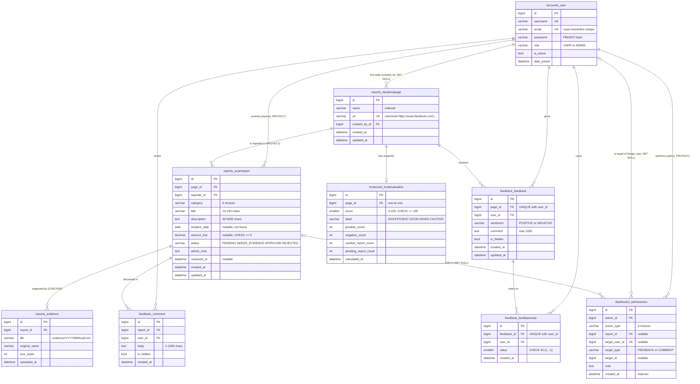

# Entity–Relationship Diagram

Generated from the real Django models (22 Nov 2026). Table names are the MariaDB table names.
`accounts_user` also has Django's standard fields (first/last name, is_staff, is_superuser, last_login),
omitted here for readability. All tables use `utf8mb4_unicode_ci`.

**Database-level rules** (enforced by MariaDB, not only by forms): unique page URL; unique user email and
username; one feedback per (page, user); one vote per (feedback, user); `amount_lost >= 0`;
vote value in (1, −1); `score <= 100`. Composite indexes: `(page_id, status)` and `(status, created_at)` on reports.

**Normalization:** all tables are in 3NF. `trustscore_trustevaluation` is the one deliberate exception, a
derived snapshot rebuilt only by `recalculate_trust()` so lists can sort and filter by score cheaply.
