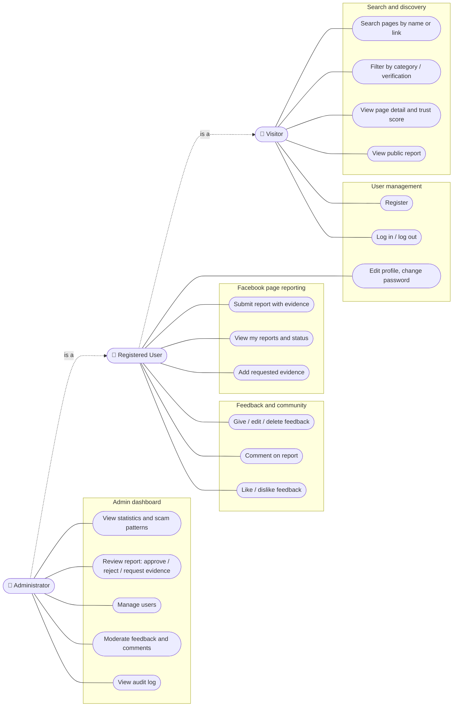

# Use Case Diagram

Mermaid has no native UML use-case notation, so this is drawn as a flowchart: actors on the left, use
cases (rounded) grouped by module. A Registered User can do everything a Visitor can; an Administrator
can do everything a Registered User can (generalization arrows).

| Actor | Use cases | Enforced by |
|---|---|---|
| Visitor | UC1–UC6 | public views |
| Registered User | + UC7–UC13 | `@login_required`; owner checks (own feedback, own report evidence) |
| Administrator | + UC14–UC18 | `@admin_required` (role ADMIN or superuser) on every dashboard view |
