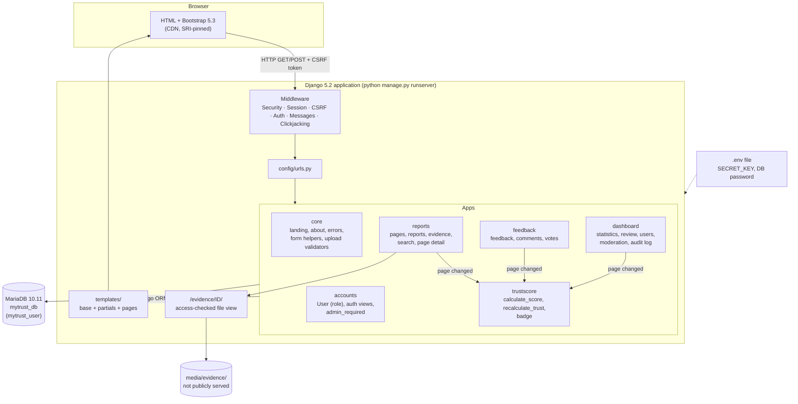

# System Architecture

Django MVT (Model–View–Template) as a modular monolith. Views stay thin; business rules live in each
app's `services.py`; validation in forms and model validators; MariaDB enforces integrity constraints.

| Dependency direction | Reason |
|---|---|
| `dashboard → feedback → reports → accounts` | No import cycles; each app only uses apps below it |
| `trustscore → reports, feedback` | The score reads reports and feedback; callers invoke `recalculate_trust()` explicitly (no hidden signals) |
| every app → `core` | Shared form styling and upload validators |
