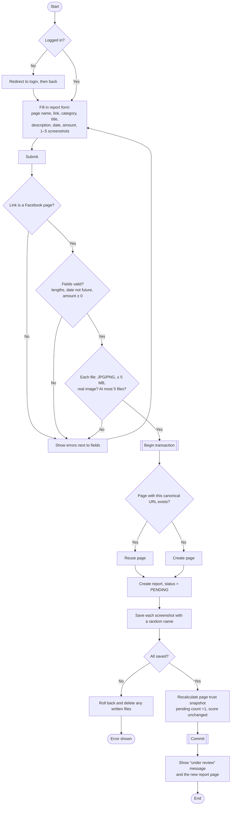
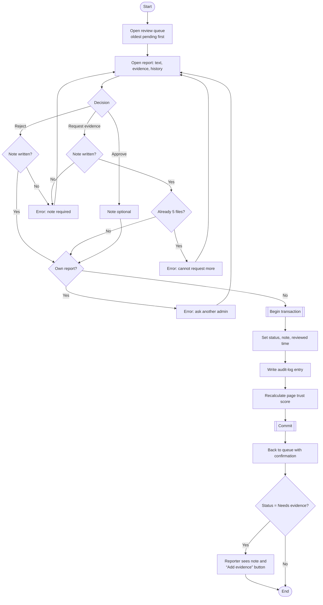

# Activity Diagrams

## Report submission (`reports.views.report_create` → `reports.services.submit_report`)

## Administrator review (`dashboard.views.report_review` → `dashboard.services.decide_report`)

